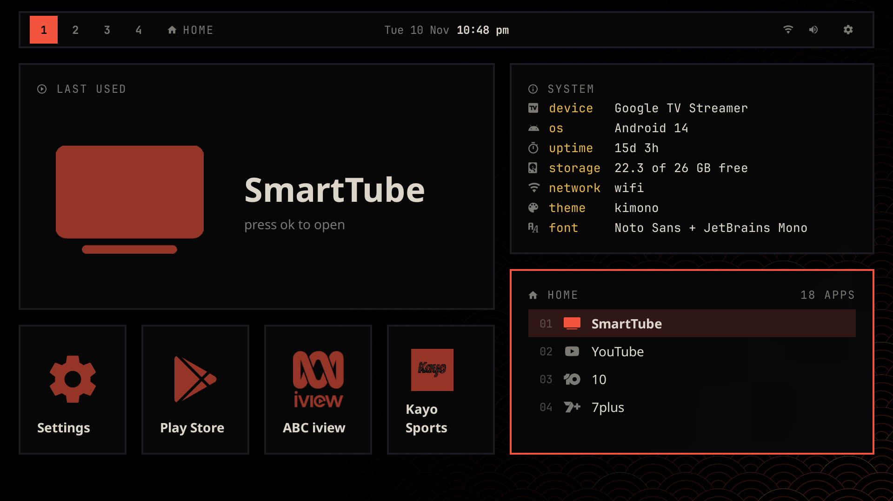
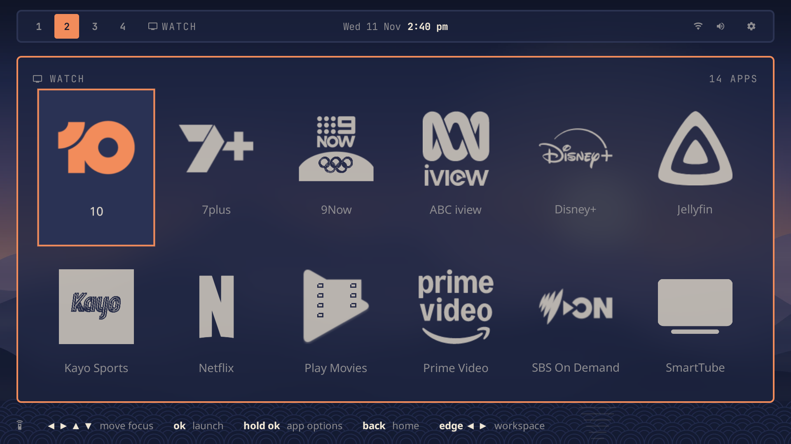
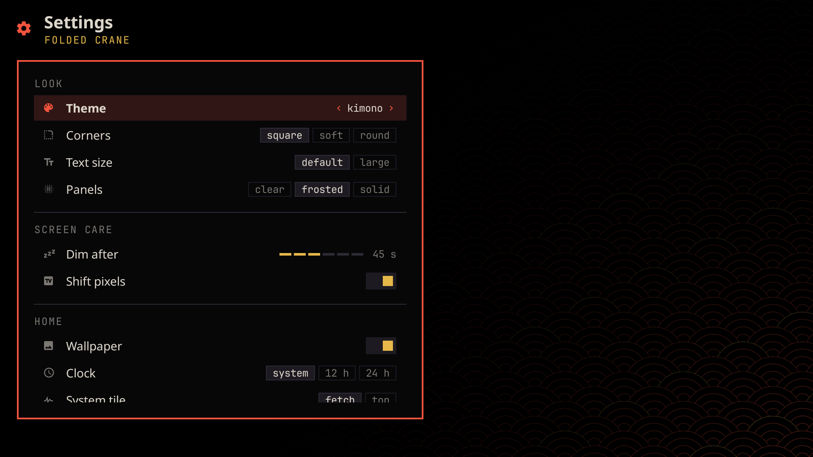

# Kimono

A calm, text-first home screen for Google TV and Android TV, inspired by [Omarchy](https://omarchy.org).

*Kimono* (着物) means "thing to wear": the launcher is what your TV wears, and themes are the garments.

> **Status:** early release. Kimono is in testing on Google Play and available as an APK from
> [GitHub Releases](https://github.com/Ranjandas/kimono/releases). Feedback and bug reports are welcome in
> [issues](https://github.com/Ranjandas/kimono/issues).

## What it does

- **Four workspaces**, switched with the number keys or Left and Right at the screen's edge: Home, Watch, Play
  and All apps. Watch and Play fill themselves from the apps you have installed; pin and reorder your own with a
  long press of OK.
- **Last used** front and centre, so getting back to what you were watching is one press, with your recent apps
  below it and a system tile (device, network, uptime, storage).
- **All apps** grouped into Watch, Listen, Play and more, with search.
- **Themes:** the default dusk Kimono, whose drawn Yūgure landscape follows the time of day, and true-black
  Kimono Sumi for OLED screens, plus themes from Omarchy's palettes (Tokyo Night, Catppuccin, Gruvbox, Rosé Pine,
  Nord, Kanagawa, Everforest). Square, soft or round corners; clear, frosted or solid panels.
- **Screen care** for OLED TVs: when idle, the wallpaper dissolves into slowly shifting pixel art.
- **Kimono as home:** an optional setting so the Home button opens Kimono (see below).
- Shortcuts to the TV's own network, sound and power settings.

| Watch | Settings |
| --- | --- |
|  |  |

## Install

Kimono needs Android 12 or later on a TV (for example the Google TV Streamer or a Chromecast with Google TV on
Android 12+).

- **Google Play:** in closed testing. Join the test to install it from the Play Store on your TV.
- **APK:** download `kimono-<version>.apk` from [Releases](https://github.com/Ranjandas/kimono/releases) and
  install it with adb (`adb install kimono-<version>.apk`) or a sideloading app. The APK and the Play build are
  signed with different keys, so uninstall one before installing the other.

Kimono shows up in the TV's apps row. Open it from there, or make it your home screen.

## Make Kimono your home screen

Google TV doesn't let you pick another home app, so Kimono offers two ways:

- **Kimono as home** (no computer needed): in Kimono, open Settings (the gear) › Kimono as home. Kimono explains
  what it does, then opens the TV's accessibility settings, where you turn on *Kimono as home*. From then on,
  pressing Home opens Kimono, after a brief flash of Google TV's home. It only watches for Google TV's home
  screen and reads nothing else; turn it off there at any time.
- **Full takeover with adb:** disables Google TV's launcher so Home goes straight to Kimono, and is undone with
  one command. See [Make Kimono the home screen](docs/DEVELOPING.md#make-kimono-the-home-screen).

## Privacy

Kimono has no accounts, ads or analytics, and sends nothing about you anywhere. It only goes online to download
the wallpaper for themes that don't draw their own. See [docs/PRIVACY.md](docs/PRIVACY.md).

## Developing

Building, installing on a TV over wireless adb, logs and recovery steps: [docs/DEVELOPING.md](docs/DEVELOPING.md).
The original plan is in [docs/PLAN.md](docs/PLAN.md) and design decisions are in [docs/adr](docs/adr).

## License

[MIT](LICENSE)
